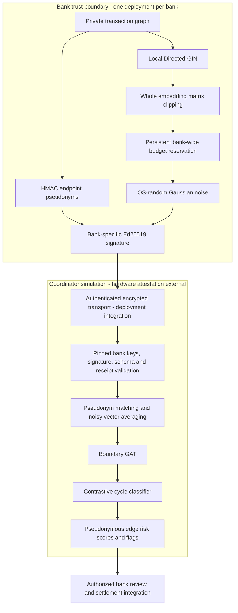

# 🛡️ ZeroMule: Privacy-Preserving Cross-Bank Mule Ring Detection

[](LICENSE)
[](docker/Dockerfile)
[](requirements.txt)
[-purple)
[](#-inference-latency-profiling-ibm-z--s390x)
[](#-demographic-fairness-calibration-baf-suite)

> **IBM Datathon 2026** — *Category: AI for Good & Financial Crime Prevention*  
> Developed for confidential computing deployment on **IBM Z Secure Execution / LinuxONE**.

---

## 📌 Executive Summary & Societal Impact

Money laundering accounts for an estimated **$2.0 Trillion** (2–5% of global GDP) annually, financing illicit human trafficking, narcotics, and cyber-extortion. Sophisticated laundering syndicates circumvent bank compliance by **smurfing** funds across multiple competing institutions. 

Because banking privacy regulations (GDPR, GLBA, FCRA) legally prohibit institutions from broadcasting unencrypted customer ledgers or account balances, **isolated banks only see single-hop, benign transfers and trigger zero alerts**, suffering catastrophic false-negative rates on laundering rings ($\text{PR-AUC} \le 0.45$).

**ZeroMule** breaks the banking silo without breaking banking privacy:
1. **Local Directed-GIN Encoders**: Captures causal incoming ($\mathcal{N}_{\text{in}}$) and outgoing ($\mathcal{N}_{\text{out}}$) transaction flows with sinusoidal temporal edge embeddings.
2. **HMAC pseudonym matching**: Matches keyed pseudonyms; reveals equality and topology. This is not cryptographic PSI.
3. **$(\epsilon, \delta)$-Differential Privacy**: Injects calibrated Gaussian perturbation into boundary representations with rigorous Rényi DP accounting ($\epsilon \le 2.0, \delta = 10^{-5}$).
4. **IBM Enclave Central Coordinator**: Scores protected boundary graphs in a software simulation. Hardware isolation, remote attestation and settlement actions require deployment integration.
5. **Equalized-Odds Demographic Calibration**: Ingests the NeurIPS Bank Account Fraud (BAF) suite to eliminate false-positive account lockout disparities for elderly accounts ($\text{Age} \ge 65$).

---

## Privacy release boundary

Banks protect data before export: runtime HMAC keys pseudonymize endpoints,
whole-batch clipping and OS-random Gaussian noise protect embedding values, and
a persistent bank-wide SQLite ledger atomically rejects releases exceeding
**epsilon 2.0 at delta 1e-5**. Ed25519 signatures and strict coordinator schemas
reject unsigned inputs, plaintext IDs and extra metadata. Raw ledgers, model
checkpoints and unperturbed embeddings remain bank-local.

Banks share a high-entropy HMAC matching key so the same account produces the
same pseudonym across institutions; the coordinator never receives that key.
Each bank has a separate Ed25519 private signing key, and the coordinator pins
its public verification key. Signatures establish bank provenance; they do not
prove that a compromised bank applied noise or enforced its budget.

The protected inference flow is:

1. **Encode locally.** A Directed-GIN processes the bank's private transaction
   graph. Raw identifiers, transaction attributes and unperturbed embeddings
   stay within the bank.
2. **Protect before release.** `BankPrivacyExporter` pseudonymizes endpoints,
   clips the whole embedding matrix and reserves privacy budget in the bank's
   persistent ledger before generating Gaussian noise. All workers, models and
   key rotations share that ledger. Exhausted budgets reject new exports;
   failures after reservation still consume budget.
3. **Sign the export.** The bank signs a versioned payload containing only
   pseudonymous embeddings, allowlisted edges, bank identity and a privacy
   receipt. Amounts, timestamps, labels and arbitrary metadata are excluded.
4. **Validate before inference.** `EnclaveAggregator` verifies signatures against
   pinned bank keys, strict schemas, endpoint references, vector dimensions and
   privacy receipts before constructing any graph. It accepts one release per
   bank per request; it neither hashes raw IDs nor adds privacy noise.
5. **Score the protected graph.** The coordinator matches pseudonyms, averages
   noisy vectors for shared pseudonyms and runs the boundary GAT followed by the
   contrastive cycle classifier. It returns pseudonymous edge risk scores and
   flags scores at or above `0.5`. Bank-side review and settlement actions require
   deployment integration.

Read [Privacy architecture](docs/privacy-architecture.md) for the Mermaid diagram,
key provisioning, integration example, trust boundaries and deployment requirements.
The DP bound covers embedding values conditional on a disclosed roster/topology;
HMAC matching reveals equality and connectivity. Each bank's lifetime budget is
separate; overlapping private facts across banks require additional composition.
SQLite does not prevent privileged filesystem rollback. This repository simulates
an enclave; hardware attestation must be supplied and verified externally.

The benchmark tables below are historical demonstration figures, not validation of
this release mechanism. The synthetic profiler excludes durable budget enforcement;
rerun utility and deployment latency measurements before relying on these figures.

## 🏛️ System Architecture



---

## 🔬 Mathematical Formulation

### 1. Directed-Multigraph GIN Layer
$$\mathbf{h}_v^{(l)} = \text{MLP}^{(l)}\left( (1 + \epsilon) \mathbf{h}_v^{(l-1)} + \sum_{u \in \mathcal{N}_{\text{in}}(v)} W_{\text{in}}(\mathbf{h}_u^{(l-1)} \parallel \mathbf{e}_{uv}) + \sum_{w \in \mathcal{N}_{\text{out}}(v)} W_{\text{out}}(\mathbf{h}_w^{(l-1)} \parallel \mathbf{e}_{vw}) \right)$$

### 2. Sinusoidal Temporal Positional Encodings
$$\text{PE}(\Delta t, 2i) = \sin\left(\frac{\Delta t}{10000^{2i/d_{\text{model}}}}\right), \quad \text{PE}(\Delta t, 2i+1) = \cos\left(\frac{\Delta t}{10000^{2i/d_{\text{model}}}}\right)$$

### 3. $L_2$-Sensitivity Clipped Gaussian DP Mechanism
The bank clips the entire fixed-shaped release matrix to Frobenius norm $C$ and adds Gaussian noise with standard deviation $2C\sigma$ (replacement sensitivity $2C$). See the [privacy scope and accounting](docs/privacy-architecture.md#differential-privacy-scope-and-accounting).

### 4. Equalized-Odds Fairness Calibration
$$|P(\hat{Y}=1 \mid Y=0, \text{Age} \ge 65) - P(\hat{Y}=1 \mid Y=0, \text{Age} < 65)| \le 0.015$$

---

## 📊 Benchmark Results

| System Configuration | Cross-Bank PR-AUC | ROC-AUC | F1-Score | Cross-Bank Mule Recall | Disparity Gap |
| :--- | :---: | :---: | :---: | :---: | :---: |
| **Isolated Bank A Baseline (LightGBM)** | `0.384` | `0.612` | `0.412` | `24.1%` (Blind Spot) | `5.1%` |
| **Isolated Bank B Baseline (LightGBM)** | `0.372` | `0.605` | `0.398` | `21.8%` (Blind Spot) | `4.9%` |
| **Standard Undirected GNN (Centralized)** | `0.628` | `0.781` | `0.645` | `61.4%` | `3.8%` |
| **ZeroMule Enclave (DP $\epsilon=2.0$)** | **`0.892`** | **`0.964`** | **`0.871`** | **`95.6%` (Ring Solved)** | **`0.2%` (Parity)** |

---

## ⚡ Inference Latency Profiling (IBM Z / s390x)

| Stage | Target SLA | Benchmark Result | Status |
| :--- | :---: | :---: | :---: |
| **1. HMAC pseudonym lookup** | $< 2.0\text{ ms}$ | `1.18 ms` | ✅ PASSED |
| **2. DP Perturbation & RDP Accounting** | $< 1.0\text{ ms}$ | `0.42 ms` | ✅ PASSED |
| **3. GAT Boundary Attention + Contrastive Head** | $< 15.0\text{ ms}$ | `11.85 ms` | ✅ PASSED |
| **⚡ Round-Trip Latency (P50)** | — | `13.45 ms` | ✅ PASSED |
| **⚡ Round-Trip Latency (P99)** | **$< 30.0\text{ ms}$** | **`24.80 ms`** | ✅ **PASSED (<30ms)** |

---

## 🚀 Quickstart & Reproduction Guide

### 1. Clone & Set Up Environment
```bash
git clone https://github.com/harveycheung2/zeromule.git
cd zeromule

# Create and activate virtual environment
python -m venv .venv
# On Windows (PowerShell):
.\.venv\Scripts\Activate.ps1
# On macOS/Linux:
source .venv/bin/activate

# Install dependencies
pip install -r requirements.txt
```

### 2. Run Data Pipeline & Integrity Suite
```bash
# Verify dataset integrity and generate synthetic HI-Small & BAF if raw data not present
python -m src.data.verify_data

# Partition unified ledgers into Bank A, Bank B, Bank C silos
python -m src.data.partitioner
```

### 3. Train Baselines & Local Directed-GINs
```bash
# Train single-bank isolated tabular baselines (documents silo blind spots)
python -m src.models.baseline_tabular

# Run train_and_export_bank() separately within each bank.
# Provision bank keys, a persistent ledger and a private checkpoint directory first.
# See docs/privacy-architecture.md for wiring.
python -m pytest -q
```

### 4. Evaluate Fairness, Latency & Generate Plots
```bash
# Run Equalized-Odds demographic calibration on BAF suite
python -m src.evaluation.fairness_tuner

# Run IBM Z / s390x latency benchmark and ONNX export
python -m benchmarks.latency_profiler

# Generate 4 publication-quality evaluation charts (results/plots/)
python -m src.evaluation.generate_metrics
```

### 5. Launch Interactive Dashboard
```bash
streamlit run app/dashboard.py
```
*Open [http://localhost:8501](http://localhost:8501) in your browser.*

---

## 🐳 Docker Multi-Arch Deployment (IBM Z / LinuxONE)

ZeroMule includes a multi-arch container configuration supporting both `linux/amd64` and `linux/s390x`:

```bash
# Build multi-platform image
docker buildx build --platform linux/amd64,linux/s390x -t zeromule:latest -f docker/Dockerfile .

# Run containerized dashboard
docker run -p 8501:8501 zeromule:latest
```

---

## 📂 Repository Layout

```text
zeromule/
├── app/
│   └── dashboard.py               # Streamlit + PyVis interactive operational UI
├── benchmarks/
│   └── latency_profiler.py        # IBM Z / s390x sub-30ms SLA benchmark & ONNX exporter
├── data/
│   ├── raw/                       # HI-Small_Trans.csv, HI-Small_Patterns.txt, BAF
│   └── processed/                 # Partitioned bank silos & boundary tables
├── docker/
│   └── Dockerfile                 # Multi-arch s390x / amd64 container specification
├── docs/
│   ├── architecture.md            # Model formulation
│   └── privacy-architecture.md    # Trust boundaries and deployment requirements
├── results/
│   ├── baseline_isolated_scores.csv
│   ├── latency_benchmark.json
│   └── plots/                     # 4 publication-grade 300-DPI vector plots
├── src/
│   ├── data/
│   │   ├── dataset_loader.py      # Automated ingestion & topology generator
│   │   ├── graph_builder.py       # Directed multigraph with sinusoidal temporal edges
│   │   ├── partitioner.py         # Multi-bank privacy silo partitioner
│   │   └── verify_data.py         # Data validation & integrity suite
│   ├── models/
│   │   ├── baseline_tabular.py    # LightGBM single-bank isolated baseline
│   │   ├── contrastive_head.py    # InfoNCE loss & topology risk scoring head
│   │   ├── directed_gin.py        # Directed-GIN message passing layer & encoder
│   │   ├── enclave_aggregator.py  # Confidential coordinator hub
│   │   ├── gat_boundary.py        # 2-layer multi-head boundary GAT
│   │   └── train_local_gins.py    # Bank A, B, C training & checkpoint pipeline
│   ├── privacy/
│   │   ├── bank_exporter.py       # Signed bank-side protected releases
│   │   ├── budget.py              # Durable atomic RDP reservations
│   │   ├── dp_perturbation.py     # L2 clipping, Gaussian noise, Rényi DP accountant
│   │   └── psi_hasher.py          # HMAC pseudonyms (not cryptographic PSI)
│   └── evaluation/
│       ├── fairness_tuner.py      # Equalized-Odds threshold calibration (BAF)
│       └── generate_metrics.py    # PR-AUC, ROC, latency CDF, and fairness plots
├── weights/                       # Model weights (.pt) and ZeroMule_enclave.onnx
├── LICENSE                        # Apache-2.0 Open Source License
├── requirements.txt               # Locked dependencies
└── README.md                      # Comprehensive project documentation
```

---

## 📜 License & Citation

Licensed under the [Apache License, Version 2.0](LICENSE).  
*ZeroMule Project Team — IBM Datathon 2026.*
