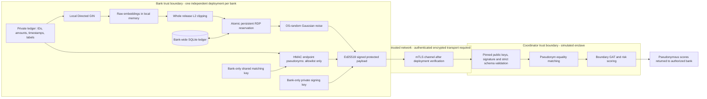

# ZeroMule privacy architecture

The supported exchange boundary is `BankPrivacyExporter.export()` → signed JSON
payload → `EnclaveAggregator.process_cross_bank_transactions()`. Raw account IDs,
transaction attributes, model checkpoints and unperturbed embeddings stay inside
the originating bank. The Python coordinator is a software simulation. It does
not supply hardware isolation, remote attestation or a settlement freeze service.



## Bank release and redaction

`PSIHasher` and `CentralPSICoordinator` retain legacy import names, but implement
**HMAC pseudonym matching, not cryptographic private set intersection (PSI)**.
Banks use the same high-entropy matching key and common account namespace. HMAC
uses a protocol domain prefix. The coordinator receives no matching key. Matching
reveals equality, roster membership, transaction connectivity, multiplicity and
bank participation. Key holders can test guesses; colluding banks can identify
accounts. Pseudonyms are personal data in many threat models, not anonymization.
Real PSI would require a separately selected, reviewed cryptographic protocol.

Configure `ZEROMULE_HMAC_KEY_B64` with base64 encoding of at least 32 random bytes,
provided by a secret manager, or inject `PSIHasher(key=...)` from a secure key
provider. Missing, malformed or short keys fail closed. There is no fallback key.
Length checks cannot establish entropy: operators must generate random keys.
Distribute keys only to banks using authenticated channels. Rotate matching keys
consistently across banks; rotation must preserve the bank privacy ledger.

The exporter constructs new records from an allowlist: `orig_account_hash`,
`dest_account_hash`, `originating_bank`. It never copies arbitrary input fields.
Amounts, times, names, labels, nested metadata and raw diagnostic norms are
excluded. Every edge endpoint must have a protected embedding. Each bank uses
an independent Ed25519 signing key. The signature covers the entire versioned
body: pseudonymous embeddings, edges, bank identity and privacy receipt.

The coordinator accepts only signed payloads from pinned bank public keys. It
rejects extra fields at every schema level, plaintext endpoint/vector keys,
invalid vectors, signatures and privacy receipts. It neither hashes IDs nor adds
noise. A 64-character hex string alone is not evidence of protection: origin
verification is also required. Reprocessing the identical signed release is
post-processing and creates no new noise or spending. Operational replay/delivery
idempotency and duplicate transaction handling belong to the transport service;
only one payload per bank is accepted per inference request. Matching state is
request-local. Duplicate estimates for a shared pseudonym are averaged.

## Differential privacy scope and accounting

The guarantee applies to **embedding values conditional on a fixed, disclosed
roster, graph topology and embedding dimension**. It does not hide whether an
account or transaction exists, or provide differential privacy for the complete
payload, topology, ledger, model weights or training process. Do not describe
this as end-to-end account-level graph DP. A deployment requiring membership or
edge DP needs an additional mechanism and joint accounting before release.

For the fixed-shaped embedding matrix `H`, the entire matrix is clipped using
its Frobenius norm: `F(H) = H / max(1, ||H||F / C)`. For replacement neighbors,
`||F(H) - F(H')||F <= 2C`, even if one transaction changes every node's embedding.
Row-wise clipping alone would not establish this graph-wide sensitivity bound.
Noise is independent Gaussian with standard deviation `2 * C * sigma` on every
coordinate. Production exposes no RNG seed. Sampling uses OS random bits and an
inverse normal CDF; finite-precision numerical sampling has not received a formal
implementation-level DP audit. Default `C=1`, `sigma=8` trades substantial utility
for conservative protection; old utility and latency figures must be rerun.

For each release, Gaussian RDP at order alpha is `alpha/(2*sigma^2)`.
The ledger stores each positive `rho=1/(2*sigma^2)` and composes all releases by
summing rho. It computes `min_alpha(alpha * sum(rho) + log(1/delta)/(alpha-1))`
over fixed orders 2 through 256, with **epsilon <= 2.0, delta = 1e-5**. A finite
order grid gives a conservative upper bound. These equations follow
[Mironov, Rényi Differential Privacy](https://arxiv.org/abs/1702.07476).
No subsampling amplification or disjoint-bank parallel composition is assumed.
Each bank enforces its own lifetime budget; if the same private fact influences
multiple banks' releases, those budgets compose and the combined guarantee may
exceed 2.0. A consortium-wide 2.0 policy needs shared accounting or an explicit
allocation across banks before deployment.

`PrivacyBudgetLedger.reserve()` starts `BEGIN IMMEDIATE`, checks cumulative
spending, appends a release and commits with SQLite `synchronous=FULL` **before**
noise generation, signing or return. Competing threads/processes use the same
lock. An excessive export is rejected without noise generation or ledger change.
Failures after reservation burn budget; there is no refund/reset operation.
Reinitializing an exporter/accountant, changing models or rotating keys does not
reset the ledger. Missing files, corrupt databases and bank mismatches fail closed.
The calculation-only `RDPAccountant` cannot authorize exports.

## Deployment requirements and example

1. Run one exporter service per bank, within its private network and filesystem.
   Training uses a bank-private checkpoint directory, returns raw embeddings only
   locally, and no longer writes raw embedding pickles to shared `weights/`.
   `train_and_export_bank()` trains on one local ledger and returns only a signed
   payload. The multi-bank partitioner is a synthetic/offline dataset tool, not a
   production cross-bank data collection service.
2. An administrator provisions one bank-wide ledger **once**. Runtime only opens
   an existing ledger; provisioning refuses any existing file. All workers,
   datasets, epochs, model versions and key rotations must use that ledger.
   Store it on durable local storage with reliable SQLite file locks, not on
   ephemeral containers or filesystems without reliable locking.
3. Protect ledger directory access, signing keys and matching keys with service
   identities, access controls and audited administration. Back up all SQLite
   journal state consistently. Never restore an older ledger or substitute a new
   path to regain budget. SQLite triggers prevent ordinary update/delete mistakes;
   they cannot stop a privileged administrator replacing files, dropping tables
   or rolling back snapshots. Strong adversarial rollback protection requires an
   external monotonic counter or authoritative append-only accounting service.
4. Provision distinct Ed25519 private signing keys at banks; pin the corresponding
   public keys at the coordinator through an authenticated configuration channel.
   Never reuse the matching key for signing. Signatures establish provenance,
   not proof that a compromised bank applied noise or enforced its budget.
5. Implement authenticated TLS transport, authorization, payload size limits,
   secure logging/retention and controlled score delivery in the deployment layer.
   No network service is supplied here. Keep private inputs and payload bodies
   out of logs. Validate the roster/topology disclosure against the threat model.
6. For actual confidential computing, deploy an appropriate hardware enclave,
   verify vendor evidence, measurement, freshness and policy remotely, and bind
   the verified identity to the transport session before releasing payloads or
   secrets. Fail closed on verification failure. Python names, payload signatures,
   Docker images and dashboard badges do not provide hardware attestation.

Illustrative wiring (run bank and coordinator blocks in their respective
processes; keys are loaded from the deployment secret provider):

```python
from src.privacy.budget import PrivacyBudgetLedger
from src.privacy.bank_exporter import BankPrivacyExporter
from src.models.enclave_aggregator import EnclaveAggregator

# One-time administrator operation on persistent bank-private storage:
# PrivacyBudgetLedger.provision('/bank/private/privacy.sqlite', 'Bank_A')

# Bank process: signing_key is a securely loaded Ed25519PrivateKey.
ledger = PrivacyBudgetLedger('/bank/private/privacy.sqlite', 'Bank_A')
exporter = BankPrivacyExporter('Bank_A', ledger, signing_key)
payload = exporter.export(local_records, local_embedding_map)
# Send only payload through the authenticated deployment transport.

# Coordinator process: bank_public_key is pinned out of band, never from payload.
coordinator = EnclaveAggregator({'Bank_A': bank_public_key}, embedding_dim=128)
result = coordinator.process_cross_bank_transactions([payload])
```

Run verification with `python -m pytest -q`. Tests cover fail-closed key loading,
allowlist redaction, Gaussian noise and clipping, RDP composition, persistent
exhaustion, crashes after reservation, concurrent process/thread reservation,
signed schema validation and protected coordinator inference. The dashboard and
latency profiler are synthetic demonstrations. The profiler deliberately uses
an ephemeral synthetic key and does not measure durable budget authorization;
its results do not certify production privacy, attestation or latency.
